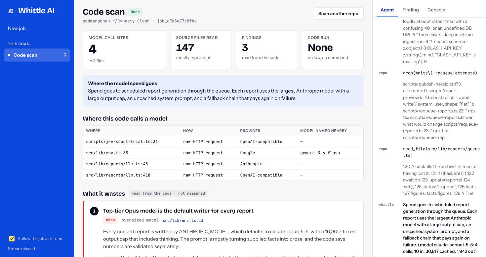
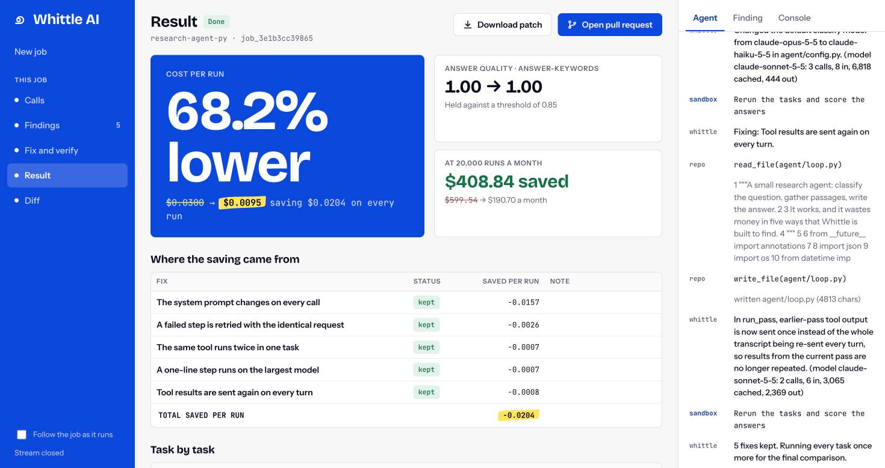
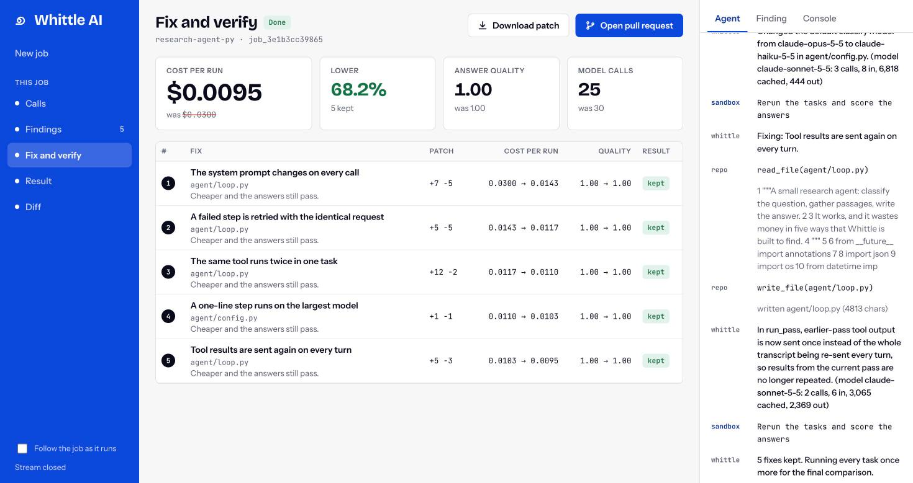
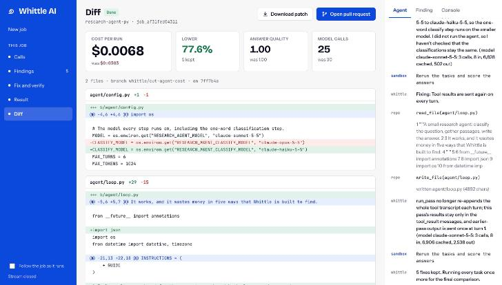
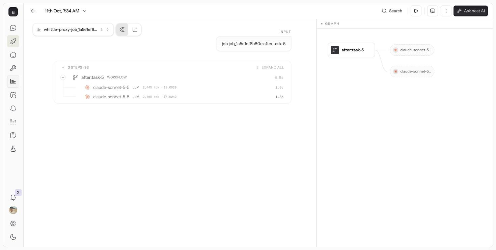

<div align="center">


# Whittle AI

[](docs/superpowers/specs/2026-10-10-agent-cost-cutter-design.md)
[](docs/plan.md)
[](docs/api-contract.md)
[](devlog.md)

[](https://neatlogs.com/hackathon)

[](https://www.npmjs.com/package/whittle-ai)

<br />

<table align="center">
  <tr>
    <td align="center" valign="top" width="270">
      <a href="https://neatlogs.com"></a><br />
      <b>neatlogs</b><br />
      <sub>The proof. Every run of the agent becomes a trace, and Whittle checks its own cost count against what neatlogs recorded</sub>
    </td>
    <td align="center" valign="top" width="270">
      <a href="https://entire.io"></a><br />
      <b>Entire</b><br />
      <sub>The memory. Its code graph finds the line to fix inside the user's repository, and every commit here carries a checkpoint</sub>
    </td>
    <td align="center" valign="top" width="270">
      <a href="https://cfo.ai"></a><br />
      <b>cfo.ai</b><br />
      <sub>The business. It turned the cost per run we measured into pricing, break-even and runway</sub>
    </td>
  </tr>
</table>

</div>

Whittle AI is for the engineer who runs an AI agent and pays its model bill.
It shows where every token and dollar goes, fixes the waste in the code, reruns
the agent, and proves the saving. A fix that does not pay, or that hurts the
answers, is taken back out.

An entry for [neatHack](https://neatlogs.com/hackathon), 10 to 12 October 2026,
by **team Attention Heads** (Padmanabhan and Sethuraman).

## Two ways to use it

**On the web.** Paste a public GitHub link, or upload a zip.

- **Scan** reads the code in any language and reports where the spend goes,
  pinned to lines. Nothing is run, so it needs no key and no command.
- **Measure and fix** runs the agent in a locked sandbox with your model key,
  then patches, reruns and scores each fix. Python, JavaScript and TypeScript.

**In your terminal**, for code that needs its own database or services:

```bash
npx whittle-ai run -- python agent.py "your question"   # record the calls, see the cost
npx whittle-ai fix -- python agent.py "your question"   # fix the waste, prove each fix here
```

Your command runs on your machine with your key, which is never written down.
`fix` sends your tracked source to Whittle (never `.env` files, keys or
anything git ignores), applies each patch to your working tree, reruns, and
keeps the patch only if it paid. Nothing is committed, and `fix --undo`
reverses it. More in [`cli/README.md`](cli/README.md).



## Real runs

All measured on 11 October with the fixing agent on `claude-sonnet-5-5`.
Nothing here is scripted.

| Run | Cost per run | Lower | Fixes kept | Answers |
|---|---|---|---|---|
| Python sample, in the sandbox | $0.0300 → $0.0095 | 68.2% | 5 of 5 | 1.00 → 1.00 |
| TypeScript sample, in the sandbox | $0.0128 → $0.0039 | 69.4% | 3 of 3 | unchanged |
| Python sample, `whittle fix` on a laptop | $0.0304 → $0.0091 | 70.1% | 5 of 5 | 0.88, bar 0.85 |
| TypeScript sample, `whittle fix` on a laptop | $0.0125 → $0.0038 | 69.6% | 3 of 3 | 0.89, bar 0.85 |

The first row is 30 added and 16 removed lines in two files, and $600 down to
$191 a month at 20,000 runs. On an earlier run one fix made the agent slightly
dearer and was reverted, with the other fixes kept.



| Each fix, rerun and scored | The diff of the kept fixes |
|---|---|
|  |  |

Runs before 12:30 PM on 11 October reported 77% to 82%. A pricing fault made
those too high; it is fixed (`f41364d`) and the figures above come after it.

## How it works

1. **Read the code.** Find every place that calls a model, in any language.
2. **Say where the money goes.** An agent reads those places and reports the
   waste, each finding pinned to its lines.
3. **Run the agent.** In a Docker sandbox with no internet access, or on your
   own machine through the CLI. Every model call is recorded with its tokens,
   cache hits and cost, and each run becomes a neatlogs trace.
4. **Find the waste it can prove.** Five detectors read the recorded calls.
   Entire's code graph finds where each one comes from in your code.
5. **Fix one thing at a time.** Whittle's agent writes a patch and the same
   tasks are rerun. The fix is kept only if the run got cheaper and the answers
   still pass. Otherwise it is reverted.
6. **Hand over the proof.** Before and after, a trace per run, the diff, a
   patch, and a pull request if you want one.

| Waste | What happens | Typical fix |
|---|---|---|
| Changing cache prefix | A timestamp in the system prompt defeats the cache | Move it out of the prefix and mark the prefix cacheable |
| Doomed retry | A failing request is sent again unchanged | Retry the failed step, not the model call |
| Duplicate tool call | The same tool runs twice with the same arguments | Remember results within the run |
| Oversized model | A one-line step runs on the largest model | Route it to a small model |
| Context bloat | Tool results are resent on every turn | Send each result once |

When things go wrong, the job says so: a fix that cannot be written is skipped,
a dropped sandbox connection is retried once, and a finished job survives a
restart.

## The three sponsor tools

Take any one away and part of the product stops working.

| Tool | What it does here | Without it |
|---|---|---|
| **neatlogs** | Every run is a trace with a span per model call. Whittle reads the traces back and checks its own cost count against them. Its own agents are traced too | No trace behind any number, and no second record to check against |
| **Entire** | `entire graph search` finds the line to fix in a repository Whittle has never seen. Every commit here carries an `Entire-Checkpoint` | Findings cannot be pinned to code, so nothing can be fixed |
| **cfo.ai** | Turned the measured cost per run into [a business plan](business/plan.md): $49 a repository a month, break-even at about five | The saving stays a number per run, with no price or runway |



Where each lives in the code: `api/costcutter/proxy/recorder.py` and
`neatlogs_client.py` for neatlogs, `api/costcutter/analyzers/locate.py` and
`agent/fixer.py` for Entire.

## Run it yourself

You need Docker running, [uv](https://docs.astral.sh/uv/) and Node.js 20 or
newer.

```bash
git clone https://github.com/padmanabhan-r/whittle.git
cd whittle
cp .env.example .env.local   # then fill in the keys below
./start.sh                   # app on http://localhost:5173
```

| Variable | For |
|---|---|
| `ANTHROPIC_API_KEY` | The sample agents' model calls |
| `WHITTLE_PROVIDER`, `WHITTLE_MODEL` | Whittle's own agent: Anthropic or any OpenAI-compatible API |
| `NEATLOGS_API_KEY` | Traces. Without it everything still runs, with no trace links |
| `GITHUB_BOT_TOKEN` | Opening pull requests. Optional |

A full sample job takes about seven minutes and costs about $0.60 in model
calls. `WHITTLE_MOCK=1 ./start.sh` runs a mock server with invented figures and
no Docker. The CLI's `analyze` and `fix` talk to this server by default;
`--api` names another.

## Status and limits

Built and run end to end: scan, sandbox runs in Python and TypeScript, the fix
and revert loop, zip upload, the CLI on npm as
[`whittle-ai`](https://www.npmjs.com/package/whittle-ai), and its fix loop.

- Pull request delivery is written and not yet run against a real repository.
- Deployment is in progress.
- The sandbox runs Python, JavaScript and TypeScript. Other languages can be
  scanned, not measured.
- A hardcoded provider address bypasses the sandbox proxy. The CLI catches it
  in JavaScript, TypeScript and Python only. Amazon Bedrock and Vertex AI are
  not recorded.
- Public repositories only on the web. One sandbox job at a time. No accounts
  yet, so it is free to use.

## Repository

| Path | What it is |
|---|---|
| `web/` | The UI (Vite, React, TypeScript) |
| `api/costcutter/` | The backend: `proxy/`, `sandbox/`, `scan.py`, `analyzers/`, `agent/`, `jobs.py`, `server.py` |
| `cli/` | The `whittle-ai` command-line tool |
| `samples/` | Two sample agents with waste built in, Python and TypeScript |
| `business/plan.md` | The business plan from cfo.ai |
| `docs/` | The design, the build plan and the API contract |
| `devlog.md` | The build log: decisions, failures, measurements and evidence |

```bash
cd api && uv sync && uv run pytest   # backend tests
cd cli && npm test                   # CLI tests
cd web && npm install && npm run build
```
