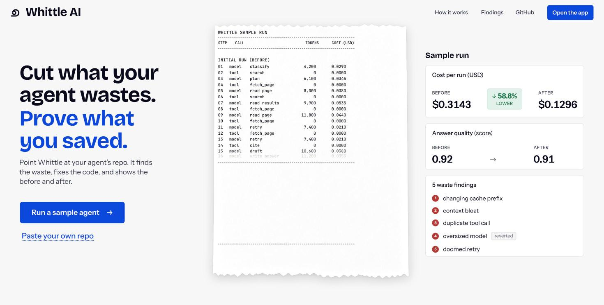
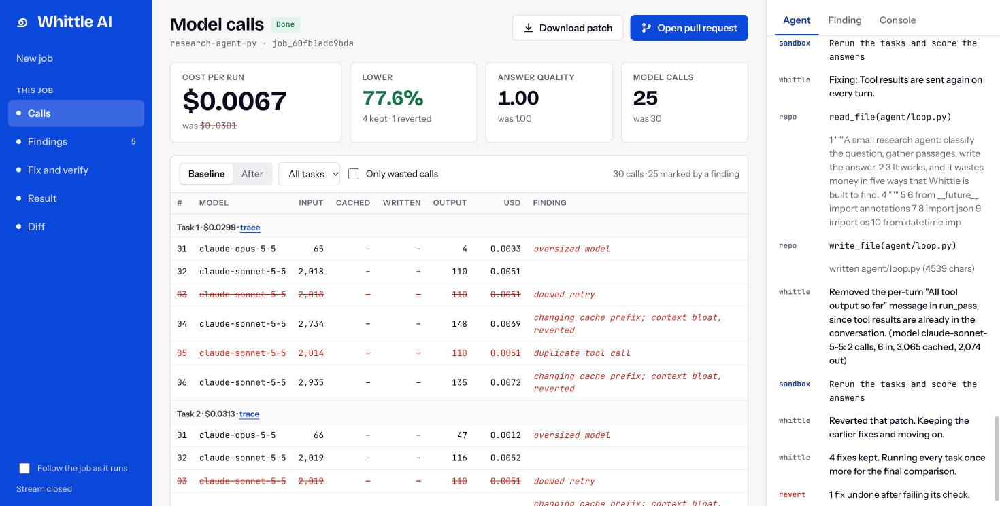
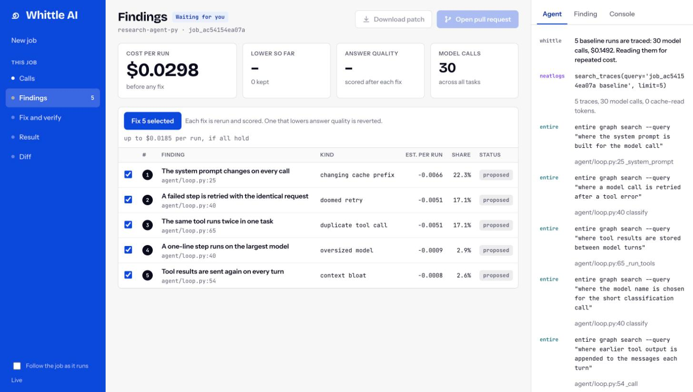

<div align="center">


# Whittle AI

### Cut what your agent wastes. Prove what you saved.

[](docs/superpowers/specs/2026-10-10-agent-cost-cutter-design.md)
[](docs/plan.md)
[](docs/api-contract.md)
[](devlog.md)

[](https://neatlogs.com/hackathon)


[](https://neatlogs.com)
[](https://entire.io)
[](https://cfo.ai)

</div>

Whittle AI is for the engineer who runs an AI agent and pays its model bill.
Point it at the agent's repository. It runs the agent in a sandbox, shows where
every token and dollar goes, fixes the waste in the code, reruns it, and proves
the saving with before and after traces. A fix that does not pay for itself, or
that lowers answer quality, is taken back out, and you watch that happen.

An entry for [neatHack](https://neatlogs.com/hackathon), 10 to 12 October 2026,
by **team Attention Heads** (Padmanabhan and Sethuraman).

## Two ways in

**Scan.** Paste a public GitHub link. Whittle reads the code, in any language,
finds every place it calls a model, and reports where the spend goes: what is
wasteful, what the code already does well, and the change to make, each pinned
to its lines. Nothing is run, so it needs no key and no run command. Scanning
our own sample agent this way found all five of the wastes built into it, and
scanning a TypeScript web app found its three: the largest model as the default,
no prompt caching, and a fallback chain that pays twice.

**Measure.** When the code can be run, Whittle runs it in a sandbox with your
model key, records every call, fixes the waste and proves the saving. The scan
proposes the run command it found, so the form is filled in for you.


## A real run

On 11 October the sample research agent went through Whittle AI end to end:
five tasks before, five after, with Whittle's own fixing agent on
`claude-sonnet-5-5`. Nothing in this section is scripted.


| | Before | After |
|---|---|---|
| Cost per run | $0.0303 | $0.0068 (77.6% lower) |
| Model calls over 5 runs | 30 | 25 |
| Input tokens | 57,869 | 7,220 |
| Cache-read tokens | 0 | 37,560 |
| Answer quality (keyword check) | 1.00 | 1.00 |
| At 20,000 runs a month | $606 | $136 |

The whole saving is 30 added and 16 removed lines in two files of the agent.

The same sample run again an hour later kept four fixes and reverted the fifth:
its rerun cost $0.0069 a run against $0.0068 before, so the patch was not worth
keeping. That is the recovery path working on a real run, not a staged one.


Three runs of the same sample on the same day gave 82.3%, 77.6% and 77.6%. The
spread comes from the fixing agent writing a slightly different patch each
time; every figure is measured from the recorded calls of that run.

## What it looks like

| Landing page | Model calls |
|---|---|
|  |  |
| **Findings** | **Diff** |
|  |  |

The landing page's receipt and its figures are an illustration. Every other
screenshot is of a real job.

## How it works

1. **Baseline.** The agent runs in a Docker sandbox on a network with no route
   to the internet. Its model calls go through a recording proxy, so every call
   is captured with no change to the agent's code, in any language, and the
   real API key never enters the container.
2. **Findings.** Detectors read the recorded calls and list the waste they can
   prove, with the calls behind each finding and the place in the code.
3. **Fix and verify.** You choose what to fix. For each finding, Whittle's
   agent reads the code, writes a patch, and the same tasks are rerun and
   scored. A fix is kept only if the run is cheaper and the answers still pass.
   Otherwise it is reverted and the earlier fixes stay.
4. **Proof.** Cost per run before and after, a trace for every run, the diff, a
   patch, and an optional pull request.

The waste it looks for:

| Waste | What happens | Typical fix |
|---|---|---|
| Changing cache prefix | A timestamp or id in the system prompt stops every request from using the cache | Move the volatile text out of the prefix and mark it cacheable |
| Doomed retry | A failing request is sent again unchanged | Retry the failed step, not the model call |
| Duplicate tool call | The same tool is called with the same arguments twice in one run | Remember results within the run |
| Oversized model | A one-line step runs on the largest model | Route that step to a small model |
| Context bloat | Whole tool results are sent again on every turn | Send each result once |

What the agent does when things go wrong, all visible in the job's event
stream:

- A fix that is not cheaper, or that drops answer quality below the threshold,
  is reverted with `git reset` and the reason is shown.
- A fix the agent cannot write is skipped with the reason, and the job moves
  on to the next finding.
- A run whose sandbox loses its connection to the proxy is retried once, so a
  network fault is not blamed on the fix.
- A finished job survives a restart of the API; a job that was running when the
  server stopped is marked failed with the reason.

## The three sponsor tools

### neatlogs

Every run of the user's agent is one neatlogs trace: a `WORKFLOW` root for the
task and an `LLM` span per model call with its tokens, cache counts, cost and
messages. The proxy writes them, so the agent under test needs no SDK
(`api/costcutter/proxy/recorder.py`). Whittle's own fixing agent is traced the
same way through `neatlogs.wrap` (`api/costcutter/agent/llm.py`), which is how
its prompt caching was checked: the same fix cost $0.0440 with caching off and
$0.0359 with it on.


Each task on the Result page links to its before and after trace. neatlogs had
trouble processing new traces on the morning of 11 October, so some links from
that day open a trace that is still pending; the trace above is from the first
job that morning.

### Entire

Two roles. While building, every commit in this repository carries an
`Entire-Checkpoint` trailer linking it to the coding session behind it, and
`entire graph` is the first lookup before any change. At runtime, Whittle calls
`entire graph search` on the user's cloned repository to find where a wasteful
call is made, and the fixing agent can ask it what a change would touch
(`api/costcutter/analyzers/locate.py`, `api/costcutter/agent/fixer.py`). The
`entire` lines in the app's Agent panel are those calls.

### cfo.ai

The business plan, built in cfo.ai from the cost per run measured above:
[`business/plan.md`](business/plan.md). It recommends $49 a month per
repository after one free job, with 10% of verified savings as the option for
larger accounts. About five paying repositories cover the running costs. The
base case reaches 66 paying repositories and $17,255 of revenue in twelve
months, and the plan says plainly that this only holds while neither founder is
paid.


## Run it

You need Docker running, [uv](https://docs.astral.sh/uv/) and Node.js 20 or
newer.

```bash
git clone https://github.com/padmanabhan-r/whittle.git
cd whittle
cp .env.example .env.local   # then fill in the keys below
./start.sh
```

Open **http://localhost:5173**. The script installs what is missing, then
starts the API on port 8787 and the UI on port 5173. Press Ctrl+C to stop both.

Keys in `.env.local`:

| Variable | For |
|---|---|
| `ANTHROPIC_API_KEY` | The sample agent's model calls |
| `WHITTLE_PROVIDER`, `WHITTLE_MODEL` | Whittle's own fixing agent: Anthropic or any OpenAI-compatible API |
| `NEATLOGS_API_KEY` | Traces. Without it everything still runs, with no trace links |
| `GITHUB_BOT_TOKEN` | Opening pull requests. Optional |

Then:

1. On the landing page, choose **Run a sample agent**, then **Run**.
2. Watch the baseline: each model call is listed with its tokens and price.
   About a minute.
3. On **Findings**, tick what to fix and press **Fix selected**.
4. Watch each fix get patched, rerun and scored. About six minutes.
5. Read the **Result**, then open the **Diff** or download the patch.

A full sample job costs about $0.60 in model calls. To use your own agent,
choose **Paste your own repo**: a public GitHub repository, the command that
runs the agent once, up to ten task inputs, and your model key, which is held
in memory for the job and never stored.

`WHITTLE_MOCK=1 ./start.sh` runs a mock server instead, with no Docker and no
keys. Its figures are invented and the app tags them "mock data". If a port is
taken, set another: `API_PORT=8790 WEB_PORT=5180 ./start.sh`.

## Status

| Part | State |
|---|---|
| Web UI: landing page and app | Built |
| Recording proxy, Docker sandbox with no internet access | Built and tested |
| Five waste detectors and the code locator | Built and tested |
| Scan mode: read any repository, no key, no command | Built and tested on a Python agent and a TypeScript app |
| Fixing agent, verify and revert, job runner, API | Built; several real jobs run end to end |
| Job state that survives a restart | Built and tested |
| neatlogs traces of every run | Built; see the note on pending traces above |
| Pull request delivery | Written, not yet run against a real repository |
| Measuring repositories that are not Python | Not built: the scan reads them, the sandbox does not run them yet |
| Deployment | In progress |

Limits worth knowing: an agent that hardcodes its provider's address bypasses
the proxy, and Whittle reports that it captured no calls. Only public
repositories are accepted. One job runs at a time.

## Repository

| Path | What it is |
|---|---|
| `web/` | The UI: landing page and app (Vite, React, TypeScript) |
| `api/costcutter/proxy/` | The recording proxy: sessions, call records, spend cap, traces |
| `api/costcutter/sandbox/` | The Docker install and run steps |
| `api/costcutter/scan.py` | Scan mode: model call sites in any language, and the agent that reads them |
| `api/costcutter/analyzers/` | The five detectors and the code locator |
| `api/costcutter/agent/` | The fixing agent |
| `api/costcutter/jobs.py`, `server.py` | The job runner and the API |
| `samples/research-agent-py/` | The sample agent, with five kinds of waste built in |
| `business/plan.md` | The business plan from cfo.ai |
| `start.sh` | Starts the API and the UI together |
| `docs/plan.md` | What is done, what is next, who owns it |
| `docs/superpowers/specs/` | The design |
| `docs/api-contract.md` | What the UI and the backend agree on, with `openapi.json` and `event-schema.json` |
| `devlog.md` | The build log: decisions, failures, measurements and evidence |
| `spikes/` | Early spike scripts and their results |
| `brainstorm/ideas.md` | The 40 rated ideas the entry was chosen from |
| `docs/neathack-rules.md` | The hackathon rules and judging weights |

## Development

```bash
cd api && uv sync && uv run pytest      # backend tests
cd web && npm install && npm run build  # type-check and build the UI
```

The contract lives in `api/costcutter/contract.py`; the UI's types in
`web/src/lib/api.ts` mirror it. Change both together, then run
`uv run python -m costcutter.export_schema` from `api/`.
