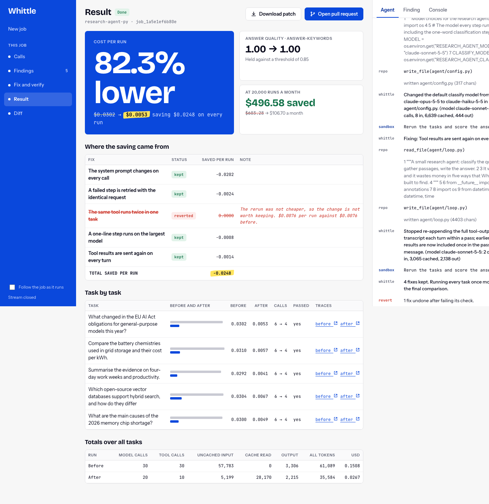

<div align="center">


# Whittle AI

### Cut what your agent wastes. Prove what you saved.

[](docs/superpowers/specs/2026-10-10-agent-cost-cutter-design.md)
[](docs/plan.md)
[](docs/api-contract.md)
[](devlog.md)

[](https://neatlogs.com/hackathon)


[](https://neatlogs.com)
[](https://entire.io)
[](https://cfo.ai)

</div>

Whittle is for the engineer who runs an AI agent and pays its model bill. Point
it at the agent's repository. It runs the agent in a sandbox, shows where every
token and dollar goes, fixes the waste in the code, reruns it, and proves the
saving with before and after traces. A fix that lowers answer quality is taken
back out, and you watch that happen.

An entry for [neatHack](https://neatlogs.com/hackathon), 10 to 12 October 2026,
by **team Attention Heads** (Padmanabhan and Sethuraman).

## Status

| Part | State |
|---|---|
| Web UI: landing page and app | Built |
| API contract and mock server | Built and tested |
| Recording proxy and Docker sandbox | Built and tested |
| Python sample agent with five kinds of waste | Built |
| Waste detectors and code locator | Built and tested |
| Fixing agent, job runner, real API | Built; one real job ran end to end |
| Trace links in neatlogs | Built, waiting on a write key |
| Pull request delivery | Written, untested |
| TypeScript sample, deployment | Not built |

`./start.sh` runs the real backend. `WHITTLE_MOCK=1 ./start.sh` runs the mock,
whose figures are invented and tagged "mock data".

## Run it

You need [uv](https://docs.astral.sh/uv/) and Node.js 20 or newer.

```bash
git clone https://github.com/padmanabhan-r/whittle.git
cd whittle
./start.sh
```

Open **http://localhost:5173**. The script installs what is missing, then
starts the API on port 8787 and the UI on port 5173. Press Ctrl+C to stop both.
The real backend needs Docker running and, in `.env.local`, a model key for
the sample runs (`ANTHROPIC_API_KEY`) and one for Whittle's own agent
(`WHITTLE_PROVIDER`, `WHITTLE_MODEL`, see `.env.example`).

1. On the landing page, choose **Run a sample agent**.
2. Pick a sample and press **Run**. "Real pace" takes about a minute.
3. Watch the baseline: each model call is listed with its tokens and price.
4. On **Findings**, tick what to fix and press **Fix selected**.
5. Watch each fix get patched, rerun and scored. One is reverted.
6. Read the **Result**, then open the **Diff** or download the patch.

If a port is taken, set another: `API_PORT=8790 WEB_PORT=5180 ./start.sh`.

## A real run

On 11 October the sample research agent went through Whittle on this machine.
Five tasks, baseline and after; Whittle's own agent on `claude-sonnet-5-5`.



| | Before | After |
|---|---|---|
| Cost per run | $0.0302 | $0.0053 (82.3% lower) |
| Model calls over 5 runs | 30 | 20 |
| Cache-read tokens | 0 | 28,170 |
| Answer quality (keyword check) | 1.00 | 1.00 |

Four fixes were kept. The fifth, for the duplicate tool call, was tried and
reverted because its rerun was not cheaper. Trace links are not in the
screenshot yet; publishing traces needs a neatlogs write key that is being set
up.

## What it looks like

| Landing page | Fix and verify |
|---|---|
|  |  |
| **Model calls** | **Result** |
|  |  |

These four screenshots are of the mock run; the one above is real.

## How it works

1. **Baseline.** The agent runs in a Docker sandbox. Its model calls go through
   a recording proxy, so every call is traced with no change to the agent's
   code, and its API key never enters the container.
2. **Findings.** Whittle reads the traces and lists the waste it can prove,
   with the calls behind each finding and the place in the code.
3. **Fix and verify.** You choose what to fix. Each fix is patched, the same
   tasks are rerun, and the answers are scored. A fix that fails is reverted.
4. **Proof.** Cost per run before and after, the diff, a patch and an optional
   pull request.

The waste it looks for first:

| Waste | What happens |
|---|---|
| Changing cache prefix | A timestamp or id in the system prompt stops every request from using the cache |
| Context bloat | Whole tool results are resent on every turn |
| Duplicate tool call | The same tool is called with the same arguments twice in one run |
| Oversized model | A simple step runs on the largest model |
| Doomed retry | A failing request is sent again unchanged |

## The three sponsor tools

| Tool | What it does in Whittle |
|---|---|
| [neatlogs](https://docs.neatlogs.com/docs) | Records every run as a trace. The agent reads those traces to find waste, and the before and after traces are the proof |
| [Entire](https://docs.entire.io) | Finds the model call sites in the user's code and what a change would touch. It also keeps a checkpoint of the coding session behind each commit in this repo |
| [cfo.ai](https://cfo.ai/neathacks) | Holds the business plan, and turns cost per run into a monthly figure |

## Repository

| Path | What it is |
|---|---|
| `web/` | The UI: landing page and app (Vite, React, TypeScript) |
| `api/` | The backend. So far the contract models and the mock server (Python, FastAPI) |
| `start.sh` | Starts the API and the UI together |
| `docs/plan.md` | **Start here to contribute:** what is done, what is next, who owns it |
| `docs/superpowers/specs/` | The design |
| `docs/api-contract.md` | What the UI and the backend agree on, with `openapi.json` and `event-schema.json` |
| `spikes/` | Phase 0 spike scripts and their results |
| `brainstorm/ideas.md` | The 40 rated ideas the entry was chosen from |
| `devlog.md` | The build log: decisions, failures and evidence |
| `CLAUDE.md`, `AGENTS.md` | Working rules for coding agents |
| `docs/neathack-rules.md` | The hackathon rules and judging weights |
| `.env.example` | The environment variables the project expects, without values |

## Development

```bash
cd api && uv sync && uv run pytest      # backend tests
cd web && npm install && npm run build  # type-check and build the UI
```

Keys go in `.env.local`, which git ignores. Copy `.env.example` to start. The
contract lives in `api/costcutter/contract.py`; the UI's types in
`web/src/lib/api.ts` mirror it. Change both together, then run
`uv run python -m costcutter.export_schema` from `api/`.

## Submission

Submissions are open on Monday 12 October 2026, 7:00 PM to 11:55 PM IST, as a
quote post of the official neatlogs post on X, with the team, the project name,
this repository and a demo video of three minutes or less.
