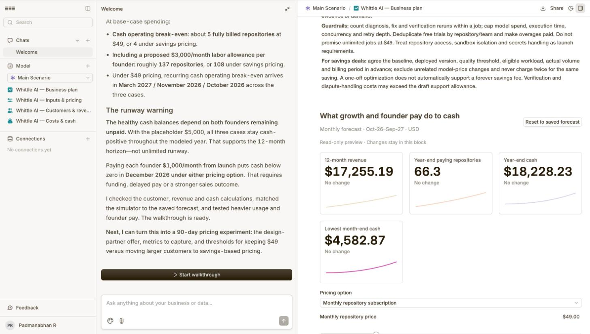

# Whittle AI: business plan

Built in [cfo.ai](https://cfo.ai) on 11 October 2026, from the costs measured
on real runs of Whittle AI. The model lives in cfo.ai as four pages (inputs and
pricing, customers and revenue, costs and cash, business plan) with three growth
cases and a founder-pay stress case. This file is its summary.

The forecast covers October 2026 to September 2027, in US dollars. It is a plan,
not traction: there are no customers and no revenue yet.

## What we gave it

These are measured, or decided by us:

| Input | Value | Source |
|---|---|---|
| Cost per run of the sample agent, before | $0.0303 | job `job_af31fed04311`, 11 October |
| Cost per run, after | $0.0068 (77.6% lower) | same job |
| Saving for that customer at 20,000 runs a month | about $470 a month | computed from the two figures |
| Our model cost per job, customer brings the key | about $0.20 | fixing agent's recorded calls |
| Our model cost per job, we pay for the runs | about $0.60 | a full sample job |
| Server | about $60 a month | one EC2 instance |
| Team | two founders, no salaries, no funding | |
| Opening cash | $5,000 | **a placeholder, not a real balance** |

Everything else below is cfo.ai's proposal and is editable in the model:
customer mix, growth, conversion, churn, software and marketing budgets.

## Pricing

**Recommended: $49 a month per repository, after one free job.** The customer
supplies the model key, and the plan includes four optimisation jobs a month,
not unlimited runs.

**Alternative: 10% of verified monthly savings**, kept for larger customers
whose production savings can be measured reliably.

| | $49 per repository | 10% of savings |
|---|---|---|
| Our sample customer pays | $49 | $47 |
| Better for us when | savings are under $490 a month | savings are over $490 a month |
| Average per repository in the forecast | $49 | $61.50, on an assumed customer mix |
| Needs | nothing extra | an agreed baseline, a quality threshold, real volume, and access to usage data every month |

The two are nearly equal on our measured sample. The savings fee earns more only
if larger accounts are landed, and it carries verification and dispute costs the
flat price does not.

Why $49 is a fair first test: adjacent developer tools list $29 a month plus
usage (Langfuse Core) and $39 a seat a month plus usage (LangSmith Plus). Those
show cost; Whittle AI changes the code and proves the saving.

## Costs

- **Per job:** about $0.40 with sandbox compute and a 20% contingency, at an
  assumed 80% of customers bringing their own key. That is $1.58 a month for a
  repository using all four jobs.
- **Fixed:** $60 server, $40 software, $100 marketing a month, and $300 once at
  launch. Card fees of 2.9% plus $0.30 per invoice.
- **Free jobs are costed** even when they do not convert.
- **Founder labour is not paid** in the base plan. It is shown separately at an
  imputed $3,000 a month each.

## Twelve-month forecast

Customer counts are expected values, so they can be fractional. Both pricing
options assume the same acquisition and churn.

| Case | Free jobs a month at start | Conversion | Paying repositories at year end | Revenue at $49 | Revenue at 10% of savings | Year-end cash at $49 |
|---|---|---|---|---|---|---|
| Conservative | 10 | 10% | 11 | $3,333 | $4,183 | $5,350 |
| Base | 20 | 20% | 66 | $17,255 | $21,657 | $18,228 |
| Optimistic | 40 | 25% | 222 | $52,236 | $65,562 | $50,591 |

In the base case, monthly recurring revenue reaches $3,251 by September 2027.

## Break-even

| | $49 per repository | 10% of savings |
|---|---|---|
| Repositories to cover recurring cash costs | about 5 | about 4 |
| Repositories to also pay both founders $3,000 a month | about 137 | about 108 |
| First month recurring costs are covered: conservative / base / optimistic | March 2027 / November 2026 / October 2026 | February 2027 / November 2026 / October 2026 |

## Runway

With both founders unpaid and the placeholder $5,000, cash stays positive in all
three cases for the whole year. The lowest month-end balance in the base case is
$4,583.

That depends entirely on nobody being paid. In the stress case, paying each
founder $1,000 a month from launch takes cash below zero in **December 2026**
under either pricing option, and the base case ends the year at minus $5,772
instead of plus $18,228. Paying ourselves needs funding, delayed pay, or more
customers than the base case assumes.

## First 90 days

1. Find ten design partners who run agents in production.
2. For each, record current spend, volume, quality tests and cost per
   successful task, then ship a measured pull request.
3. Test whether they pay $49 after the free job, and whether they come back
   for regression checks.

Guardrails the plan sets: cap model spend, run time and retries per job; one
free trial per repository; paid overages; no unlimited jobs at $49. For savings
deals, agree the baseline, the quality threshold and the billing period first,
and never charge twice for the same saving.

## What this plan does not show

No demand has been tested. The customer mix, conversion and churn are
assumptions. The 77.6% saving is one sample agent with waste built in; the
forecast deliberately assumes a lower saving (20% attainable, 75% of that
realised) for real customers. Tax, legal, security review and compliance costs
are not included.
