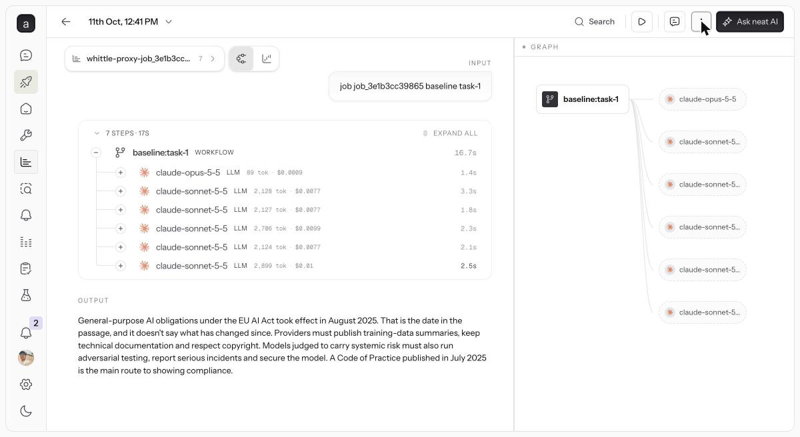
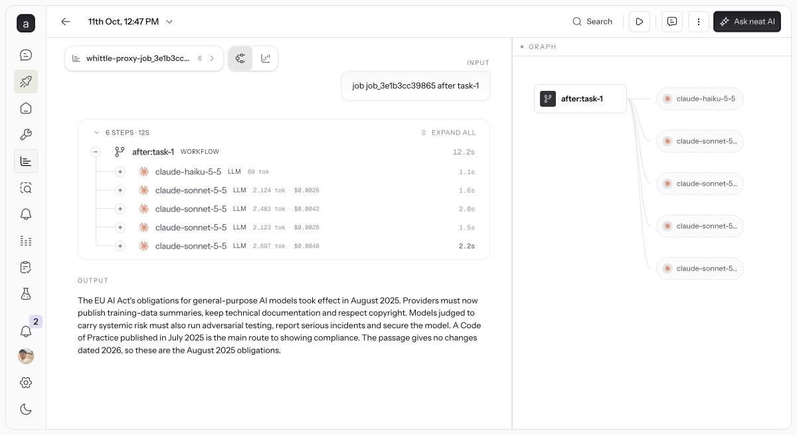

# neatlogs in this project

Evidence for the "You used neatlogs" and "The agent improved" rows. Every run
Whittle makes in its sandbox goes through its recording proxy, which opens one
neatlogs trace per run: a WORKFLOW root named `<phase>:<task>` and one LLM span
per proxied model call, carrying the model, tokens, cache reads and writes, cost
and latency (`api/costcutter/proxy/recorder.py`). Whittle's own agent is traced
the same way (`whittle-scan`, `whittle-fix` workflows).

Trace links have the form `https://app.neatlogs.com/traces/<id>` and open for
members of the project; neatlogs has no public share link as of 11 October, so
the two traces below are also kept here as screenshots.

## The pair: one task, before and after the kept fixes

Job `job_3e1b3cc39865`, the Python research-agent sample, task 1, measured on
11 October 2026 with `claude-sonnet-5-5` on both sides.

| | Before | After |
|---|---|---|
| Trace | https://app.neatlogs.com/traces/c0cce5b378185e2e7562705f0b64c72b | https://app.neatlogs.com/traces/6f88917a54da7d28d857385d937056c3 |
| Model calls | 6 | 5 |
| First call | claude-opus-5-5, 89 tokens, $0.0009 | claude-haiku-5-5, 69 tokens |
| A 2,124-token call | $0.0077 | $0.0026 |
| Wall time | 16.7 s | 12.2 s |
| Cost of the run | $0.0296 | $0.0094 |

What changed between them, each a fix Whittle wrote, reran and kept: the
classification step moved from the largest model to the smallest; the system
prompt stopped changing per call, so the cache now hits (the same 2,124-token
request costs a third); a failed step is no longer retried with the identical
request; a duplicate tool call is answered from memory; tool results are sent
once instead of on every turn. Across the five tasks the cost per run fell from
$0.0300 to $0.0095 (68.2%), with answer scores of 1.00 on both sides.

## Where else neatlogs is used

- The scan and fix agents' own calls are traced, so a job's agent pane and its
  neatlogs trace agree (`api/costcutter/agent/llm.py`, `ensure_neatlogs`).
- After a baseline, Whittle reads the traces back through the neatlogs API and
  checks its own cost count against what neatlogs recorded
  (`api/costcutter/neatlogs_client.py`, `JobRunner._check_with_neatlogs`).
- The command-line tool's recordings are ingested as traces too, so a run on
  the developer's machine shows up beside sandbox runs.
